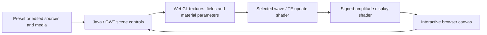

# EM-Flow · ElectromagneticFlow

**An interactive, browser-based wave sandbox built on Paul Falstad's Ripple/RippleGL.**

[中文](README.zh-CN.md) · [Open the public app](https://patr1ck2005.github.io/EM-Flow/) · [Screenshot gallery](docs/showcase/gallery.html) · [Build notes](docs/build.md)

Real screenshot of the public application: **Two-Source**, **Waves = Sound**, scalar TM mode. The palette shows signed wave amplitude, rather than energy density. Captured 2026-10-17; [provenance and settings](docs/showcase/manifest.json).

## Explore waves directly

Choose a preset, watch it evolve, and change sources or media to test an intuition.

| Explore | What to look for |
| --- | --- |
| Two sources | Alternating constructive and destructive interference |
| Single slit | The transmitted wave spreading beyond the aperture |
| Refraction | A change in wavefront direction and wavelength across a medium boundary |
| Editable scenes | Sources, obstacles and media controlled through the browser interface |

The source contains a WebGL scalar-wave update and a separate TE field-update shader. The UI exposes scalar TM/TE choices and a `Rigorous FDTD -TE` choice. These are implementation modes, not a claim of general 3D Maxwell validation. Spatial resolution, boundaries, damping and the selected equation affect the result.

<table>
<tr><td></td><td></td></tr>
<tr><td>Single-Slit · visible-light setting · scalar TM mode.</td><td>Refraction · visible-light setting · scalar TM mode.</td></tr>
</table>

All three images are unmodified browser captures of the deployed app. They are qualitative demonstrations, with UI slider values recorded in the manifest. They are not calibrated measurements, convergence studies or screenshots of a freshly built local checkout.

## Run the application

**The verified entry is the [public browser app](https://patr1ck2005.github.io/EM-Flow/).** It requires a WebGL-capable browser. Select a preset from the top-right list; `Stopped` pauses the evolution, and `Clear Waves` clears the current field.

The source checkout is a legacy **Java + GWT + WebGL** project. It includes `war/Ripple.html` and shader/JavaScript assets, but does **not** include the generated `war/ripple/ripple.nocache.js` entry or a pinned command-line build setup. Serving `war/` before GWT compilation is insufficient.

[Build notes](docs/build.md) preserve the original Eclipse/GWT workflow, expected output structure, conditional static-serving command and Electron packaging route. A one-command source build has not been verified.

## How a scene becomes a frame

Source entry points:

- [Scene controller](src/com/falstad/ripple/client/RippleSim.java): examples, controls, import/export and wave settings.
- [GWT module](src/com/falstad/ripple/Ripple.gwt.xml): Java entry point and public resources.
- [HTML and shaders](war/Ripple.html) and [WebGL runtime](war/ripple.js).
- [Preset index](src/com/falstad/ripple/public/setuplist.txt) and [example scenes](src/com/falstad/ripple/public/examples).

This repository is `Patr1ck2005/EM-Flow`, default branch `master`. Related `ripplegl` or `ElectromagneticFlow` forks can have different code and build layouts. The deployed page is not pinned to the source commit used for these notes; its preset list differs from the checked-in list.

## Versions and verification

| Item | Evidence |
| --- | --- |
| Source snapshot inspected | `29c3279efb1e77ace959126b9f6e797b04b2f07f` |
| In-source Ripple version string | 1.4 |
| GWT module DTD | 2.7.0 reference; this does not pin the installed SDK |
| Bundled matrix library | glMatrix 0.9.5 |
| Electron wrapper | package 0.0.1; manifest declares Electron ≥9.3.1 (legacy route) |
| Verified here | Public app loads; Two-Source, Single-Slit and Refraction presets render |
| Remaining build gap | No generated GWT entry, pinned SDK or verified automated source build |

No benchmark or quantitative solver-accuracy claim is made by these screenshots. [Gallery and evidence](docs/showcase/gallery.html).

## Origin and license

This project builds on **Paul Falstad's Ripple/RippleGL**, with acknowledgements to the original project and the Electron-wrapper work credited to **Immortalin** in the earlier README.

The inherited Java source headers state **GNU GPL version 2 or later** (`GPL-2.0-or-later`), including the original copyright and warranty notice. Preserve those notices and the applicable GPL terms when redistributing or modifying the program. This documentation does not relicense the inherited code.
