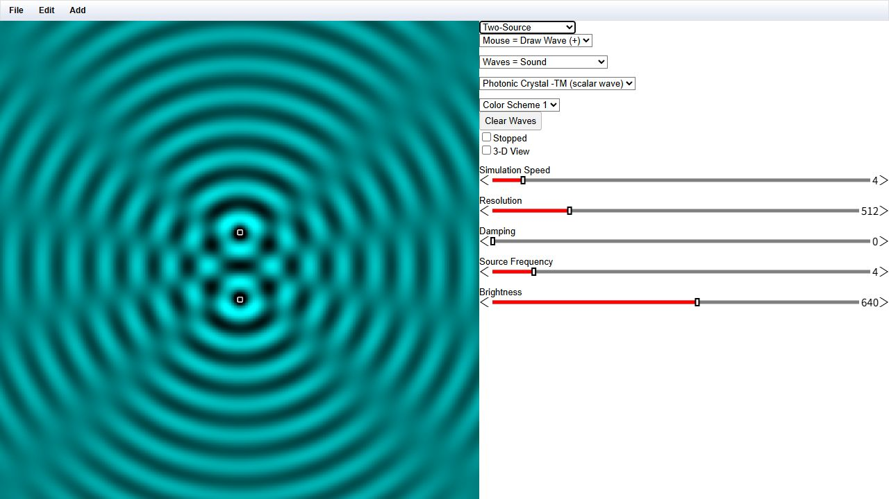
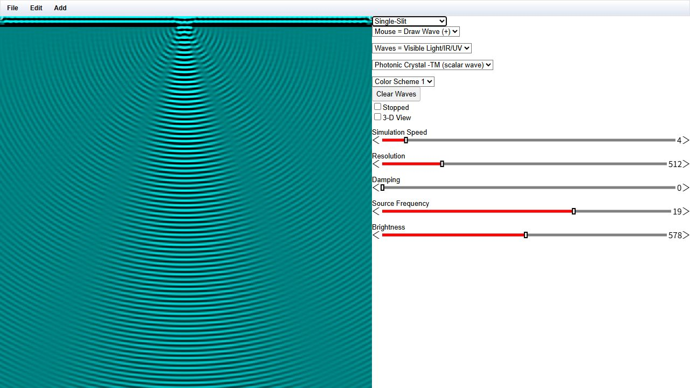
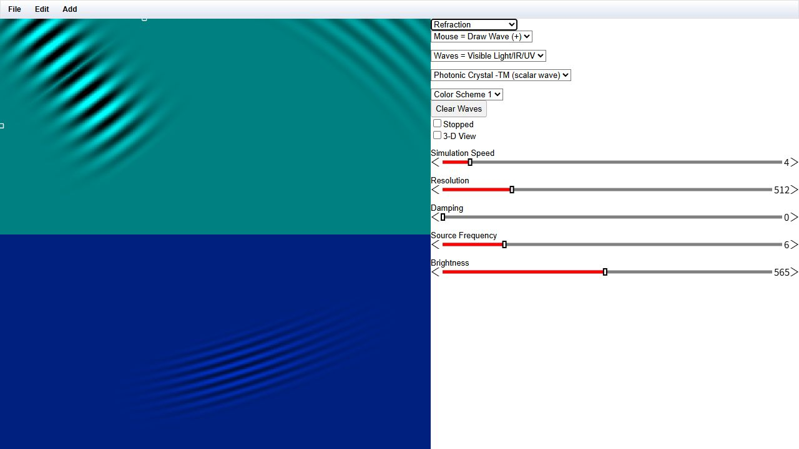

# EM-Flow · ElectromagneticFlow

**基于 Paul Falstad 的 Ripple／RippleGL 构建的浏览器交互式波动实验沙盒。**

[English](README.md) · [打开公开应用](https://patr1ck2005.github.io/EM-Flow/) · [截图图集](docs/showcase/gallery.html) · [构建说明](docs/build.md)

公开应用实屏截图：**Two-Source**、**Waves = Sound**、标量 TM 模式。颜色表示有符号波幅，不是能量密度。截图日期为 2026-10-17；[来源与设置](docs/showcase/manifest.json)随图记录。

## 直接探索波动

选择预设、观察演化，再改变波源或介质检验直觉。

| 场景 | 可以观察什么 |
| --- | --- |
| 双源 | 相长与相消干涉交替出现 |
| 单缝 | 透过孔径的波向横向展开 |
| 折射 | 介质界面两侧波前方向及波长变化 |
| 可编辑场景 | 通过浏览器控制波源、障碍物与介质 |

源码包含 WebGL 标量波更新和独立的 TE 场更新 shader。界面提供标量 TM／TE 选项，以及 `Rigorous FDTD -TE` 选项；它们是实现模式，不代表已经完成通用三维 Maxwell 求解器验证。分辨率、边界、阻尼和所选方程都会影响结果。

<table>
<tr><td></td><td></td></tr>
<tr><td>Single-Slit · 可见光设置 · 标量 TM 模式。</td><td>Refraction · 可见光设置 · 标量 TM 模式。</td></tr>
</table>

三张图均为公开应用的未修改浏览器截图，滑块值记录在 manifest 中。它们用于定性展示，不是校准测量、收敛分析，也不是本轮从源码重新构建的本地程序截图。

## 运行

**已核实入口为[公开浏览器应用](https://patr1ck2005.github.io/EM-Flow/)。** 需要支持 WebGL 的浏览器。右上列表选择场景，`Stopped` 暂停演化，`Clear Waves` 清除当前波场。

源码是历史 **Java + GWT + WebGL** 项目，包含 `war/Ripple.html`、shader 与 JavaScript，但没有生成后的 `war/ripple/ripple.nocache.js`，也没有固定版本的命令行构建配置。未编译 GWT 前，仅提供 `war/` 静态服务不能运行完整应用。

[构建说明](docs/build.md)保留原有 Eclipse／GWT 工作流、预期输出结构、编译后适用的静态服务命令及 Electron 打包路线。目前没有核实一条命令完成的源码构建。

## 场景到画面的流程

源码入口：

- [场景控制器](src/com/falstad/ripple/client/RippleSim.java)：示例、控制、导入导出与波动设置。
- [GWT 模块](src/com/falstad/ripple/Ripple.gwt.xml)：Java 入口与公开资源。
- [HTML 与 shader](war/Ripple.html)、[WebGL 运行代码](war/ripple.js)。
- [预设索引](src/com/falstad/ripple/public/setuplist.txt)与[预设文件](src/com/falstad/ripple/public/examples)。

本仓库为 `Patr1ck2005/EM-Flow`，默认分支为 `master`。相关 `ripplegl` 或 `ElectromagneticFlow` fork 可能使用不同代码和构建结构。公开部署没有绑定到本次检查的源码提交，部署页的预设列表与检入列表不同。

## 版本与核验范围

| 项目 | 依据 |
| --- | --- |
| 检查的源码快照 | `29c3279efb1e77ace959126b9f6e797b04b2f07f` |
| 源码中的 Ripple 版本字符串 | 1.4 |
| GWT 模块 DTD | 引用 2.7.0；不等于固定了 SDK 版本 |
| 附带矩阵库 | glMatrix 0.9.5 |
| Electron 包装 | package 0.0.1，声明 Electron ≥9.3.1，为历史路线 |
| 本次实际核验 | 公开应用装载，双源、单缝、折射三个预设渲染 |
| 构建缺口 | 没有 GWT 生成入口、固定 SDK 或已验证自动构建 |

截图不提供性能基准或定量求解精度结论。[完整图集与证据](docs/showcase/gallery.html)。

## 来源与许可

项目继承 **Paul Falstad 的 Ripple／RippleGL**。原 README 还将 Electron 包装的早期工作归功于 **Immortalin**。

继承的 Java 源文件头声明 **GNU GPL 第 2 版或更高版本**（`GPL-2.0-or-later`），保留原版权及无担保说明。修改与再分发程序时应保留相关声明并遵守适用 GPL 条款；本轮文档没有改变继承代码的许可。
